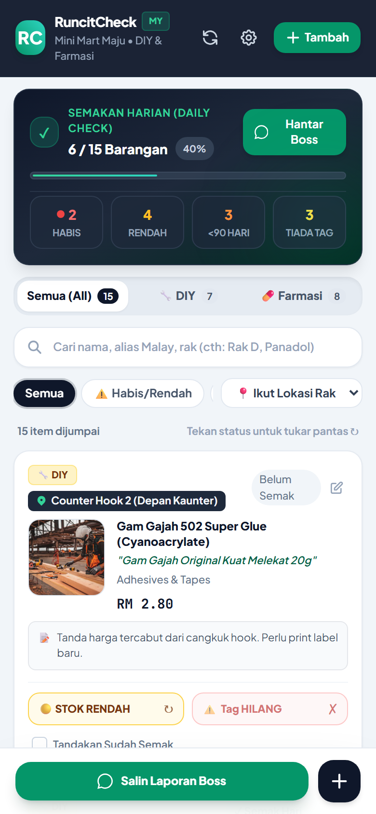
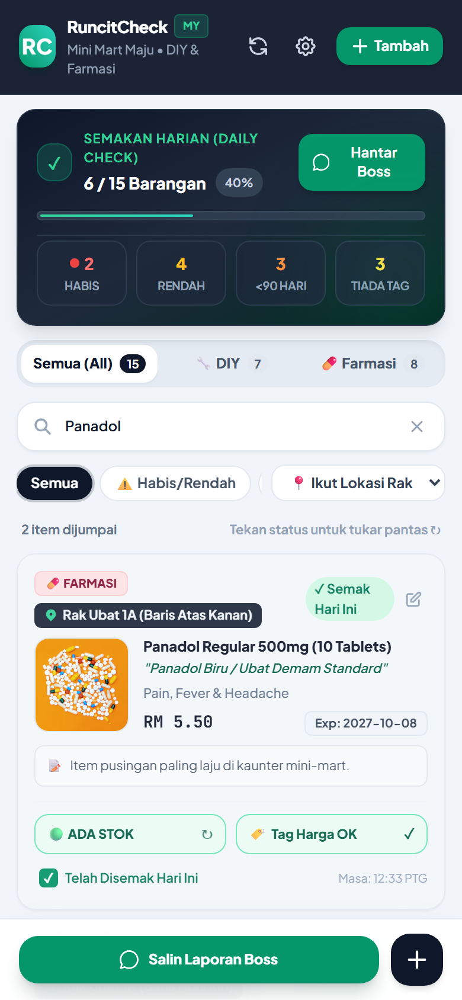
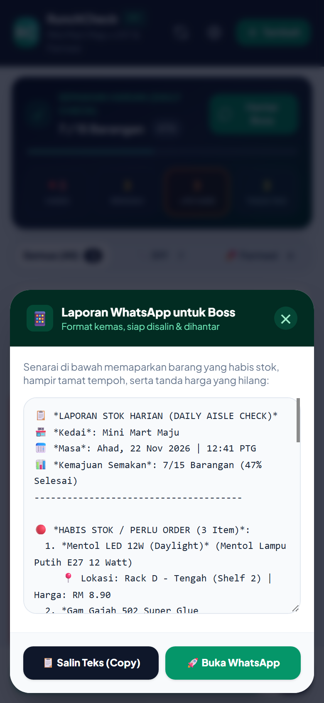

# RuncitCheck - Malaysian Mini-Mart DIY & Medicine Stock Ranger

A clean, fast, mobile-first Web App built with **HTML5**, **Tailwind CSS**, and **Vanilla JavaScript** to empower mini-mart staff to perform daily aisle checks, manage stock levels, verify price tags, track medicine expiry dates, and dispatch WhatsApp-ready audit summaries directly to the store manager.

---

  
  &nbsp;&nbsp;
  
  &nbsp;&nbsp;
  

---

## 🚀 Key Features

### 1. Section Tabs & Instant Search
- **Tabs**: Switch smoothly between **"Semua (All)"**, **"DIY Section"**, and **"Farmasi / Medicine"** with live item count badges.
- **Instant Search**: Search by item name, local Malay alias (e.g., *Panadol Merah*, *Gam Gajah 502*), category, or exact shelf rack location (e.g., *Rack D - Tengah*, *Rak Ubat 1A*).
- **Fast Filter Chips**:
  - `Semua (All)`
  - `⚠️ Habis/Rendah (Low / Out of Stock)`
  - `⏳ Luput <90h (Expiring Soon)`
  - `🏷️ Tiada Tag (Missing Price Tag)`
  - `👁️ Belum Semak (Unchecked Today)`
- **Shelf-First Sorting**: Sort by shelf rack walk order, expiry date, stock urgency, or item name.

### 2. Ergonomic One-Handed Mobile Cards
- Designed for walking store aisles with a phone in one hand.
- **Stock Status One-Tap Cycle**:
  - `🟢 ADA STOK` (In Stock) ➔ `🟡 STOK RENDAH` (Low Stock) ➔ `🔴 HABIS STOK` (Out of Stock) ➔ `🟢 ADA STOK`
  - Instant tactile feedback with Web Audio beeps and mobile haptic vibration (`navigator.vibrate`).
- **One-Tap Price Tag Verification**:
  - Checkbox toggle: `🏷️ Tag Harga OK ✓` vs `⚠️ Tag HILANG ✗` (pulsing red alert for tags needing reprinting).
- **Automated Expiry Date Monitoring**:
  - Automatically flags medicine batches:
    - 🚨 **EXPIRED** / **CRITICAL (<30 days)**: High-contrast red badge with days remaining.
    - ⏳ **EXPIRING (<90 days)**: Amber alert badge.
    - 🟢 **SAFE (>90 days)**: Clean neutral indicator.
- **Daily Inspection Check**:
  - Quick checkbox to mark items inspected during the current shift with timestamp.

### 3. Add / Edit / Photo Reference
- Bottom-sheet mobile modal to create or modify items.
- Fields: Name, Malay/Local Alias, Section (DIY or Farmasi), Category (with auto-suggest datalist), Shelf Location, Price (RM), Expiry Date, Stock Status, Price Tag Check, Notes, and Photo Reference.
- **Dual Photo Support**: Upload camera images directly from your phone (stored as persistent base64 data URLs) or paste an image URL.
- **Offline Vector Fallbacks**: Includes handcrafted, lightweight SVG illustrations for common Malaysian goods (Panadol, Strepsils, Cap Kapak, Mentol LED, Super Glue, PVC Tap, etc.).
- **Tap-to-Zoom Visual Reference**: Tap any thumbnail to open high-resolution visual inspection with rack location and specifications.

### 4. Preloaded Malaysian Mini-Mart Inventory
- **DIY Section**:
  - Mentol LED 12W (Daylight)
  - Plug Top 3-Pin 13A (SIRIM)
  - Gam Gajah 502 Super Glue (Cyanoacrylate)
  - Black Electrical Tape 18mm x 10m
  - Padlock Heavy Duty 40mm Brass
  - Kepala Paip PVC 1/2" (Water Tap)
  - Cable Tie 200mm (100 Pcs / Pack)
- **Medicine / Farmasi Section**:
  - Panadol ActiFast 500mg (10 Tablets)
  - Panadol Regular 500mg (10 Tablets)
  - Strepsils Honey & Lemon (8 Lozenges) *(Expiring soon)*
  - Minyak Cap Kapak No.3 (14ml) *(Expiring soon)*
  - Pil Chi Kit Teck Aun (Sachet) *(Missing price tag)*
  - Gaviscon Liquid Sachet (5 x 10ml) *(Expiring soon & Low stock)*
  - Counterpain Analgesic Cream 30g
  - Hansaplast Plaster Kain Elastik (10 Strips)

### 5. Daily Check Summary & Boss WhatsApp Export
- **Dashboard Progress Card**: Live tally of total items checked, % completion bar, and quick-filter metric counts for Out of Stock, Low Stock, Expiring, and Missing Tags.
- **Reset Daily Check**: Clear daily check marks to start a fresh morning/afternoon audit shift while preserving catalog data.
- **Hantar WhatsApp ke Boss**: Generates a WhatsApp-formatted markdown text with emojis, store details, timestamp, and organized bullet lists of:
  - 🔴 Out of Stock items
  - 🟡 Low Stock items
  - ⏳ Expiring items (<90 days)
  - 🏷️ Missing Price Tags with prices to print on barcode stickers.
- Features both **"Salin Teks (Copy)"** and **"Buka WhatsApp (Direct Link)"**.

### 6. Persistence & Offline-First Backup
- Automatically saves all state changes to browser `localStorage`.
- **JSON Backup Download**: Export catalog as `runcitcheck-backup-[date].json`.
- **JSON Import**: Restore data seamlessly onto any other staff phone.
- **Factory Reset**: One-click reset to the authentic Malaysian sample dataset.

---

## 📱 Mobile Viewport Testing

The web app was tested on an emulated **390 x 844** viewport (standard iPhone 12/13/14 size) using headless Chrome with touch emulation enabled:
- Touch target sizes meet accessibility guidelines (minimum 44px).
- Safe area inset padding (`pb-safe`) for notch and bottom home bars.
- Zero horizontal layout shift or button truncation.

---

## 🛠️ Tech Stack
- **HTML5**: Semantic tags, accessible forms, datalists.
- **Tailwind CSS**: CDN utility styling with custom color extensions.
- **Vanilla JavaScript (ES Modules)**: Fast, zero-dependency, reactive UI rendering with Web Audio API sound synthesis and Vibration API haptics.
- **Storage**: Browser `localStorage` + JSON Import/Export.
