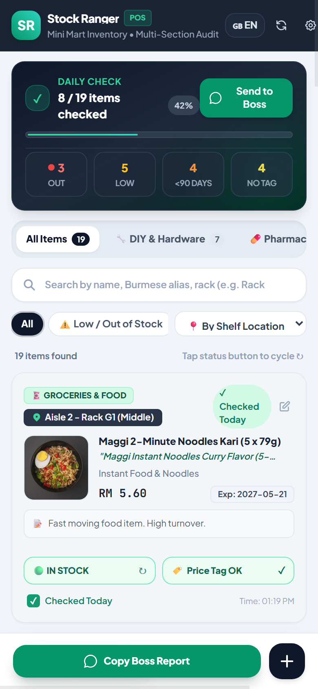
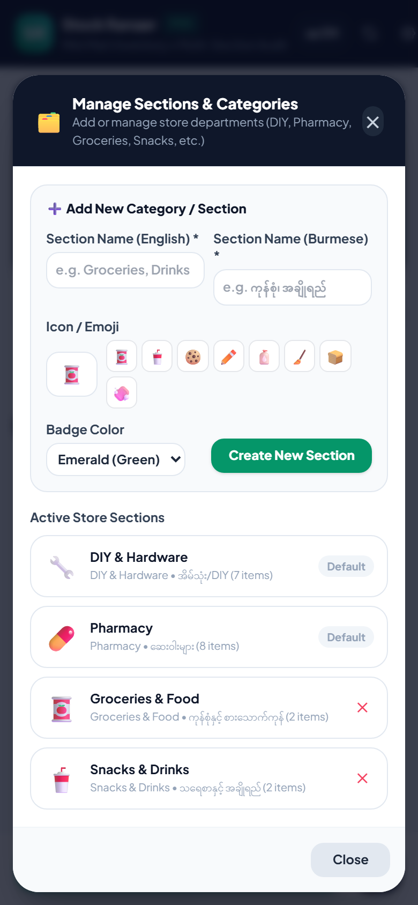
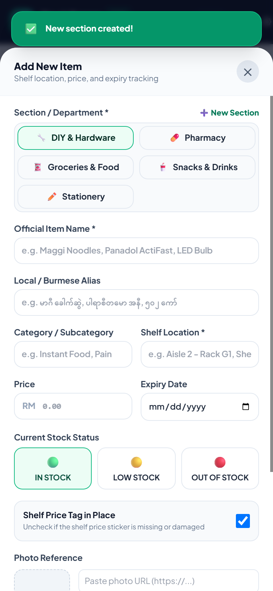

# Stock Ranger (စတော့ စစ်ဆေးရေး) - Mini-Mart Multi-Category Stock Checker

A clean, fast, mobile-first Web App built with **HTML5**, **Tailwind CSS**, and **Vanilla JavaScript** to empower mini-mart staff to perform daily aisle checks, manage stock levels, verify price tags, track medicine expiry dates, and dispatch WhatsApp-ready audit summaries directly to the store manager.

Supports **Dynamic Store Categories** (DIY, Pharmacy, Groceries, Snacks & Drinks, Stationery, etc.) and **Dual Languages**: **English (🇬🇧)** and **Burmese (🇲🇲 မြန်မာဘာသာ)**!

---

  
  &nbsp;&nbsp;
  
  &nbsp;&nbsp;
  

---

## 🚀 Key Features

### 1. Dynamic Category & Section Management
- **Beyond DIY & Pharmacy**: Easily add and audit any mini-mart department:
  - 🔧 **DIY & Hardware** (အိမ်သုံး/DIY)
  - 💊 **Pharmacy** (ဆေးဝါးများ)
  - 🥫 **Groceries & Food** (ကုန်စုံနှင့် စားသောက်ကုန်)
  - 🥤 **Snacks & Drinks** (သရေစာနှင့် အချိုရည်)
  - ✏️ **Stationery** (စာရေးကိရိယာ)
  - 🧴 **Personal Care & Household** (လူသုံးကုန်)
  - *Or create any custom section on the fly!*
- **Dynamic Horizontal Tab Bar**: Scrollable top navigation bar featuring live item counts for each department plus an instant `➕ Add` button.
- **In-Form Quick Creation**: Add / Edit Item modal lets you select from active categories or tap `➕ New Section` without leaving the form.
- **Category Manager Modal**: Create new sections with English name, Burmese name, custom emoji icons (🥫, 🥤, ✏️, 🧴, 🧹, 🍞, etc.), and badge color themes.

### 2. Dual Language Support (English 🇬🇧 & Burmese 🇲🇲)
- **Instant Language Switcher**: Tap the language button in the header (`🇬🇧 EN` / `🇲🇲 မြန်မာ`) to switch instantly across the entire application without page reloads.
- **Fully Localized Catalog**: Every item has official names, English aliases, and native Burmese aliases (e.g. *၁၂ ဝပ် LED မီးသီး*, *ပါရာစီတမော အနီ*, *၅၀၂ ကော်*, *မာဂီ မာဆလာခေါက်ဆွဲ*).
- **Localized WhatsApp Reports**: Generates managerial audit summaries in both English and Burmese based on the active language setting.

### 3. Ergonomic One-Handed Mobile Cards
- Designed for walking store aisles with a phone in one hand.
- **Stock Status One-Tap Cycle**:
  - `🟢 IN STOCK / ပစ္စည်းရှိ` ➔ `🟡 LOW STOCK / ပစ္စည်းနည်း` ➔ `🔴 OUT OF STOCK / ပစ္စည်းပြတ်` ➔ `🟢 IN STOCK`
  - Instant tactile feedback with Web Audio beeps and mobile haptic vibration (`navigator.vibrate`).
- **One-Tap Price Tag Verification**:
  - Checkbox toggle: `🏷️ Price Tag OK / ဈေးနှုန်းကတ် ရှိ ✓` vs `⚠️ Tag MISSING / ဈေးနှုန်းကတ် မရှိ ✗` (pulsing red alert for tags needing reprinting).
- **Automated Expiry Date Monitoring**:
  - Automatically flags medicine and food batches:
    - 🚨 **EXPIRED / CRITICAL (<30 days)**: High-contrast red badge with days remaining.
    - ⏳ **EXPIRING (<90 days)**: Amber alert badge.
    - 🟢 **SAFE (>90 days)**: Clean neutral indicator.
- **Daily Inspection Check**:
  - Quick checkbox to mark items inspected during the current shift with timestamp.

### 4. Add / Edit / Photo Reference
- Bottom-sheet mobile modal to create or modify items.
- Fields: Name, Burmese/Local Alias, Section/Department, Category (with auto-suggest datalist), Shelf Location, Price (RM), Expiry Date, Stock Status, Price Tag Check, Notes, and Photo Reference.
- **Dual Photo Support**: Upload camera images directly from your phone (stored as persistent base64 data URLs) or paste an image URL.
- **Offline Vector Fallbacks**: Includes handcrafted SVG illustrations for DIY, Medicine, Groceries, and Snacks.
- **Tap-to-Zoom Visual Reference**: Tap any thumbnail to open high-resolution visual inspection with rack location and specifications.

### 5. Daily Check Summary & Manager WhatsApp Export
- **Dashboard Progress Card**: Live tally of total items checked, % completion bar, and quick-filter metric counts for Out of Stock, Low Stock, Expiring, and Missing Tags.
- **Reset Daily Check**: Clear daily check marks to start a fresh morning/afternoon audit shift while preserving catalog data.
- **WhatsApp Export**: Generates clean formatted text with emojis, store details, timestamp, and organized bullet lists of:
  - 🔴 Out of Stock items (with category icons & locations)
  - 🟡 Low Stock items (with stock quantities)
  - ⏳ Expiring items (<90 days with expiry dates)
  - 🏷️ Missing Price Tags with prices to print.
- Features both **"Copy Text / စာသား ကူးယူမည်"** and **"Open WhatsApp / WhatsApp ဖွင့်မည်"**.

### 6. Persistence & Offline-First Backup
- Automatically saves all items and custom categories to browser `localStorage`.
- **JSON Backup Download**: Export catalog and custom departments as `stock-ranger-backup-[date].json`.
- **JSON Import**: Restore data seamlessly onto any other staff phone.
- **Factory Reset**: One-click reset to the default multi-category dataset.

---

## 📱 Mobile Viewport Testing

The web app was tested on an emulated **390 x 844** viewport (standard iPhone 12/13/14 size) using headless Chrome with touch emulation enabled:
- Touch target sizes meet accessibility guidelines (minimum 44px).
- Safe area inset padding (`pb-safe`) for notch and bottom home bars.
- Zero horizontal layout shift or button truncation across both English and Burmese scripts.

---

## 🛠️ Tech Stack
- **HTML5**: Semantic tags, accessible forms, datalists.
- **Tailwind CSS**: CDN utility styling with custom color extensions.
- **Vanilla JavaScript (ES Modules)**: Fast, zero-dependency, reactive UI rendering with Web Audio API sound synthesis and Vibration API haptics.
- **Typography**: Support for English and Burmese Unicode fonts (`Plus Jakarta Sans`, `Padauk`, `Pyidaungsu`, `Myanmar Text`).
- **Storage**: Browser `localStorage` + JSON Import/Export.
