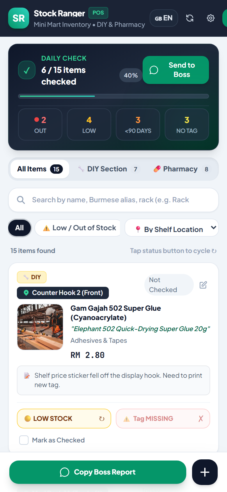
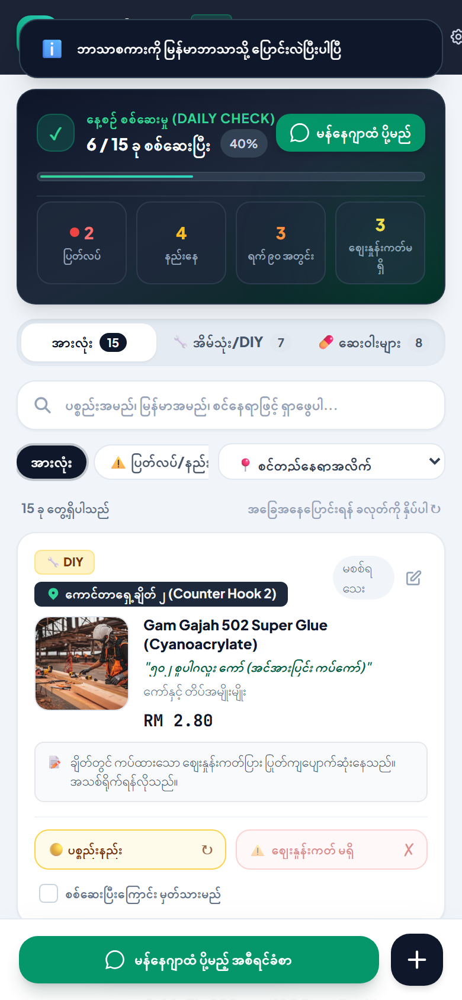
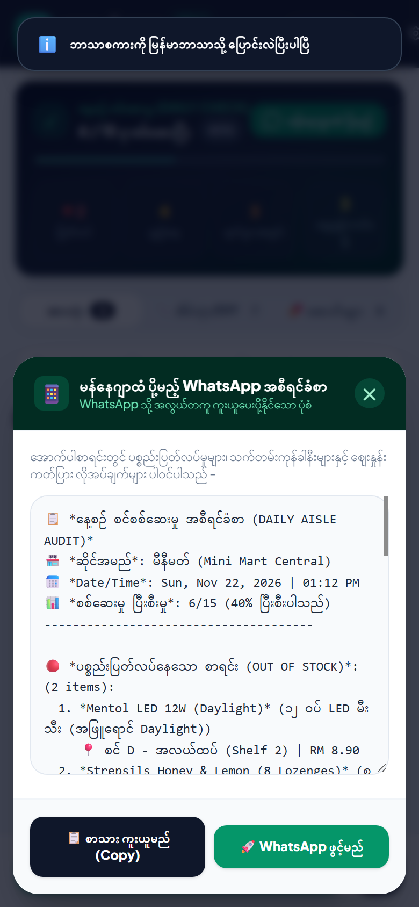

# Stock Ranger (စတော့ စစ်ဆေးရေး) - Mini-Mart DIY & Medicine Stock Checker

A clean, fast, mobile-first Web App built with **HTML5**, **Tailwind CSS**, and **Vanilla JavaScript** to empower mini-mart staff to perform daily aisle checks, manage stock levels, verify price tags, track medicine expiry dates, and dispatch WhatsApp-ready audit summaries directly to the store manager.

Supports **Dual Languages**: **English (🇬🇧)** and **Burmese (🇲🇲 မြန်မာဘာသာ)** with instant one-tap switching!

---

  
  &nbsp;&nbsp;
  
  &nbsp;&nbsp;
  

---

## 🚀 Key Features

### 1. Dual Language Support (English 🇬🇧 & Burmese 🇲🇲)
- **Instant Language Switcher**: Tap the language button in the header (`🇬🇧 EN` / `🇲🇲 မြန်မာ`) to switch instantly across the entire application without page reloads.
- **Fully Localized Catalog**: Every item has official names, English aliases, and native Burmese aliases (e.g. *၁၂ ဝပ် LED မီးသီး*, *ပါရာစီတမော အနီ*, *၅၀၂ ကော်*).
- **Localized WhatsApp Reports**: Generates managerial audit summaries in both English and Burmese based on the active language setting.

### 2. Section Tabs & Instant Search
- **Tabs**: Switch smoothly between **"All Items / အားလုံး"**, **"DIY Section / အိမ်သုံး/DIY"**, and **"Pharmacy / ဆေးဝါးများ"** with live item count badges.
- **Instant Search**: Search by item name, local Burmese alias (e.g., *ပါရာစီတမော*, *၅၀၂ ကော်*), category, or exact shelf rack location (e.g., *Rack D*, *ဆေးစင် ၁A*).
- **Fast Filter Chips**:
  - `All / အားလုံး`
  - `⚠️ Low / Out of Stock (ပြတ်လပ်/နည်းနေ)`
  - `⏳ Expiring (<90d) (သက်တမ်းကုန်ခါနီး)`
  - `🏷️ Missing Price Tag (ဈေးနှုန်းကတ်မရှိ)`
  - `👁️ Unchecked Today (မစစ်ရသေးသောပစ္စည်း)`
- **Shelf-First Sorting**: Sort by shelf rack walk order, expiry date, stock urgency, or item name.

### 3. Ergonomic One-Handed Mobile Cards
- Designed for walking store aisles with a phone in one hand.
- **Stock Status One-Tap Cycle**:
  - `🟢 IN STOCK / ပစ္စည်းရှိ` ➔ `🟡 LOW STOCK / ပစ္စည်းနည်း` ➔ `🔴 OUT OF STOCK / ပစ္စည်းပြတ်` ➔ `🟢 IN STOCK`
  - Instant tactile feedback with Web Audio beeps and mobile haptic vibration (`navigator.vibrate`).
- **One-Tap Price Tag Verification**:
  - Checkbox toggle: `🏷️ Price Tag OK / ဈေးနှုန်းကတ် ရှိ ✓` vs `⚠️ Tag MISSING / ဈေးနှုန်းကတ် မရှိ ✗` (pulsing red alert for tags needing reprinting).
- **Automated Expiry Date Monitoring**:
  - Automatically flags medicine batches:
    - 🚨 **EXPIRED / CRITICAL (<30 days)**: High-contrast red badge with days remaining.
    - ⏳ **EXPIRING (<90 days)**: Amber alert badge.
    - 🟢 **SAFE (>90 days)**: Clean neutral indicator.
- **Daily Inspection Check**:
  - Quick checkbox to mark items inspected during the current shift with timestamp.

### 4. Add / Edit / Photo Reference
- Bottom-sheet mobile modal to create or modify items.
- Fields: Name, Burmese/Local Alias, Section (DIY or Pharmacy), Category (with auto-suggest datalist), Shelf Location, Price (RM), Expiry Date, Stock Status, Price Tag Check, Notes, and Photo Reference.
- **Dual Photo Support**: Upload camera images directly from your phone (stored as persistent base64 data URLs) or paste an image URL.
- **Offline Vector Fallbacks**: Includes handcrafted, lightweight SVG illustrations for common goods (Panadol, Strepsils, Axe Oil, LED Bulb, Super Glue, PVC Tap, etc.).
- **Tap-to-Zoom Visual Reference**: Tap any thumbnail to open high-resolution visual inspection with rack location and specifications.

### 5. Preloaded Mini-Mart Inventory
- **DIY Section**:
  - Mentol LED 12W (Daylight) — *၁၂ ဝပ် LED မီးသီး*
  - Plug Top 3-Pin 13A (SIRIM) — *၃ ပင် ခေါင်း ပလပ်*
  - Gam Gajah 502 Super Glue — *၅၀၂ စူပါဂလူး ကော်*
  - Black Electrical Tape 18mm x 10m — *ဝါယာကြိုး ပတ်တိပ် အနက်*
  - Padlock Heavy Duty 40mm Brass — *၄၀ မမ ကြေးသော့*
  - Kepala Paip PVC 1/2" (Water Tap) — *၁/၂ လက်မ PVC ရေဘုံဘိုင်ခေါင်း*
  - Cable Tie 200mm (100 Pcs) — *ကေဘယ်ကြိုးချည်ကြိုး*
- **Medicine / Pharmacy Section**:
  - Panadol ActiFast 500mg — *ပါရာစီတမော အက်တစ်ဖတ်စ် (အနီ)*
  - Panadol Regular 500mg — *ပါရာစီတမော အပြာ*
  - Strepsils Honey & Lemon — *စထရက်ပ်ဆီ ပျားရည်သံပုရာ လည်ချောင်းနာ သကြားလုံး*
  - Minyak Cap Kapak No.3 (14ml) — *ပုဆိန်တံဆိပ် လိမ်းဆေးဆီ*
  - Pil Chi Kit Teck Aun — *တက်အွန် ဝမ်းဆေးလုံး*
  - Gaviscon Liquid Sachet — *ဂါဗစ်စကွန် ရင်ပူ/အစာမကြေ သောက်ဆေးရည်*
  - Counterpain Analgesic Cream 30g — *ကောင်တာပိန်း အကြောပြေလိမ်းဆေး*
  - Hansaplast Plaster Kain Elastik — *ဟန်ဆာပလက်စ် ပိတ်သား အနာကပ် ပလာစတာ*

### 6. Daily Check Summary & Manager WhatsApp Export
- **Dashboard Progress Card**: Live tally of total items checked, % completion bar, and quick-filter metric counts for Out of Stock, Low Stock, Expiring, and Missing Tags.
- **Reset Daily Check**: Clear daily check marks to start a fresh morning/afternoon audit shift while preserving catalog data.
- **WhatsApp Export**: Generates clean formatted text with emojis, store details, timestamp, and organized bullet lists of:
  - 🔴 Out of Stock items
  - 🟡 Low Stock items
  - ⏳ Expiring items (<90 days)
  - 🏷️ Missing Price Tags with prices to print on barcode stickers.
- Features both **"Copy Text / စာသား ကူးယူမည်"** and **"Open WhatsApp / WhatsApp ဖွင့်မည်"**.

### 7. Persistence & Offline-First Backup
- Automatically saves all state changes to browser `localStorage`.
- **JSON Backup Download**: Export catalog as `stock-ranger-backup-[date].json`.
- **JSON Import**: Restore data seamlessly onto any other staff phone.
- **Factory Reset**: One-click reset to the default sample dataset.

---

## 📱 Mobile Viewport Testing

The web app was tested on an emulated **390 x 844** viewport (standard iPhone 12/13/14 size) using headless Chrome with touch emulation enabled:
- Touch target sizes meet accessibility guidelines (minimum 44px).
- Safe area inset padding (`pb-safe`) for notch and bottom home bars.
- Zero horizontal layout shift or button truncation across both English and Burmese scripts.

---

## 🛠️ Tech Stack
- **HTML5**: Semantic tags, accessible forms, datalists.
- **Tailwind CSS**: CDN utility styling with custom color extensions.
- **Vanilla JavaScript (ES Modules)**: Fast, zero-dependency, reactive UI rendering with Web Audio API sound synthesis and Vibration API haptics.
- **Typography**: Support for English and Burmese Unicode fonts (`Plus Jakarta Sans`, `Padauk`, `Pyidaungsu`, `Myanmar Text`).
- **Storage**: Browser `localStorage` + JSON Import/Export.
